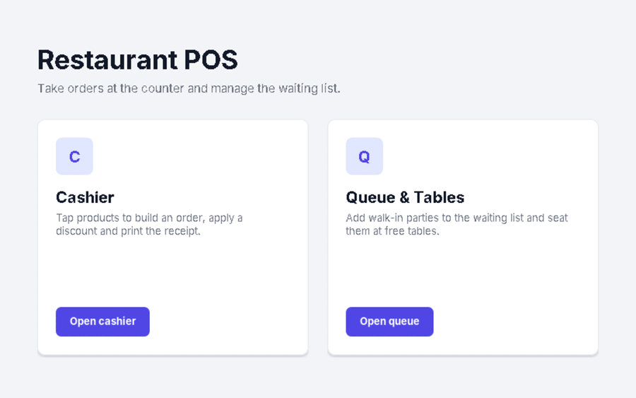
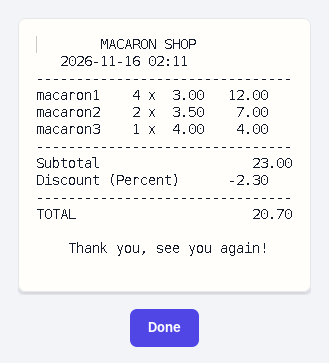
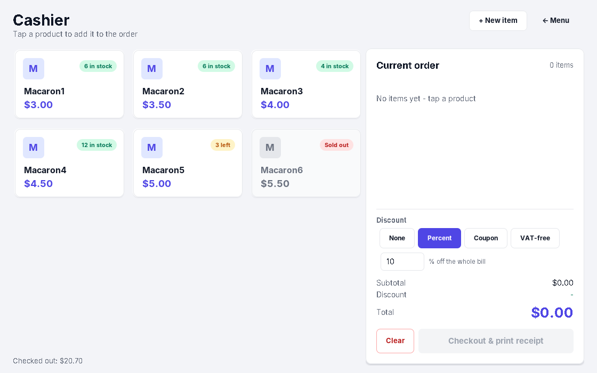
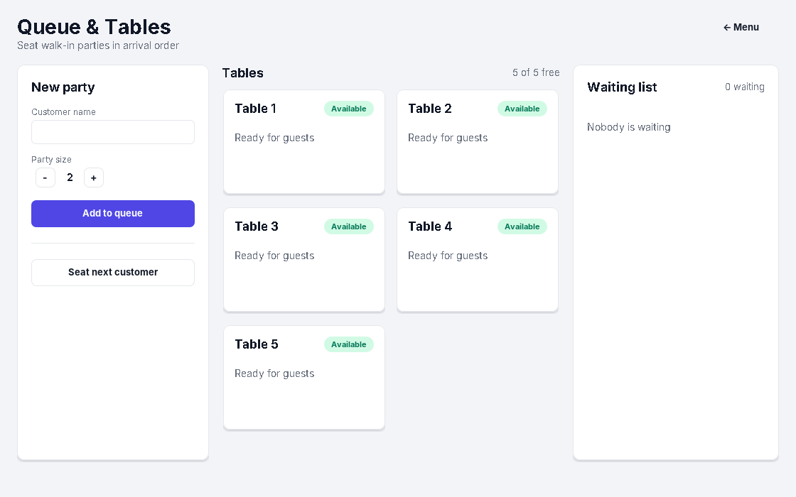
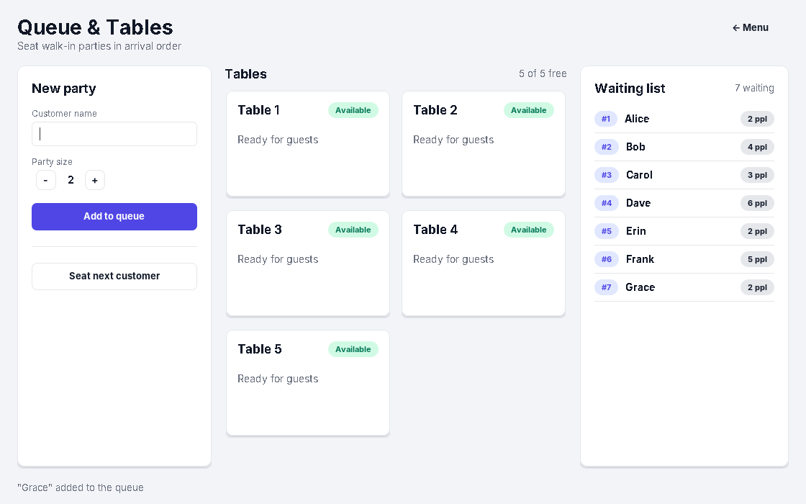
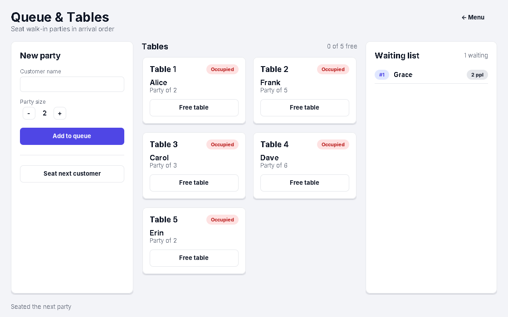
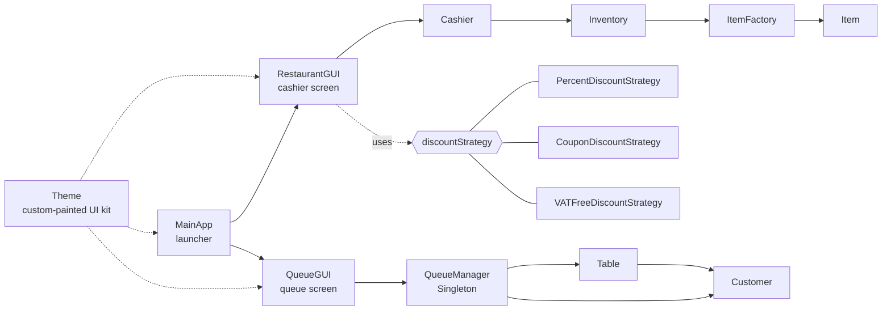

# Restaurant POS & Queue System (Java Swing)

A desktop **Point-of-Sale and table-queue application for a small restaurant/bakery**, written in plain Java with Swing. It has two modules behind a launcher menu: a **cashier** (inventory, orders, discounts) and a **waiting-queue / table manager** (FIFO queue, seat the next party, free a table). The project is built to demonstrate object-oriented design: the **Strategy**, **Singleton** and **Factory** patterns, plus encapsulation, abstraction and polymorphism.



## Table of Contents
1. [Features](#features)
2. [Screenshots](#screenshots)
3. [Tech stack](#tech-stack)
4. [Architecture](#architecture)
5. [How it works](#how-it-works)
6. [OOP concepts and design patterns](#oop-concepts-and-design-patterns)
7. [Results / outputs](#results--outputs)
8. [How to run](#how-to-run)
9. [Repo structure](#repo-structure)
10. [Limitations](#limitations)
11. [Project Facts (for resume)](#project-facts-for-resume)

## Features

**Launcher (`MainApp`)**
- Modern flat launcher with two module cards: *Cashier* and *Queue & Tables*.

**Cashier module (`RestaurantGUI`)**
- Product tiles (name, price, live stock chip: green "in stock", amber "N left" when 3 or fewer, red "Sold out"); six seeded demo products (`Macaron1`-`Macaron6`, one of them sold out).
- **Tap-to-add order**: each tap adds one unit; the order panel shows lines with a `- qty +` stepper, per-line subtotal and an item count. Stock is validated against what is already in the order; reducing a line to 0 removes it.
- **Discount pills**: None / Percent / Coupon / VAT-free, each a separate strategy class, with live subtotal, discount and total:
  - *Percent* - user-entered percentage off
  - *Coupon* - fixed amount off, only if the bill reaches a minimum spend (the GUI sets the minimum to 4x the coupon amount)
  - *VAT-free* - removes 7 % VAT (`price / 1.07`)
- **Checkout & print receipt**: deducts stock through `Cashier.processOrder`, shows a paper-style receipt dialog (date/time, lines, subtotal, discount, total) and refreshes the tiles.
- **+ New item** dialog to add a product or restock an existing one (validated inputs).

**Queue module (`QueueGUI`)**
- Add a party (name + size stepper, Enter key works) to a FIFO waiting list.
- **Seat next customer**: dequeues the head of the queue and seats them at the first free table; status line reports when nobody is waiting or no table is free.
- Five table cards with status chip (Available / Occupied), guest name, party size and a per-table **Free table** button.
- Waiting list shows queue position (#1, #2, ...) and party size; header shows "N of 5 free" and "N waiting".

**UI toolkit (`Theme`)**
- Small pure-Swing design system: colour palette, font fallback (Inter / Segoe UI / Helvetica Neue / Roboto / Arial), rounded cards with soft shadows, flat buttons with hover/pressed states, chips, stepper and rounded text fields - all custom-painted with `Graphics2D` anti-aliasing, no third-party look-and-feel library.

## Screenshots

Captured from the real application running under a virtual display (Xvfb), driven by a script that clicks the tiles/buttons and types into the fields. Seed/demo data only.

| Launcher | Cashier (empty order) |
|---|---|
|  |  |

| Order with 10 % discount (subtotal $23.00, total $20.70) | Receipt |
|---|---|
|  |  |

| After checkout (stock updated, "Sold out" tile) | New item dialog |
|---|---|
|  |  |

| Queue (empty) | 7 parties waiting |
|---|---|
|  |  |

| 5 tables occupied, 2 waiting | Table 2 freed, next party seated |
|---|---|
|  |  |

> Note: there is **no login, user-account or admin panel** - access control is not implemented. See [Limitations](#limitations).

## Tech stack
- **Language:** Java (standard library only – `javax.swing`, `java.awt`, `java.util`)
- **UI:** Swing (`JFrame`, `JDialog`, `BorderLayout`, `GridLayout`, `BoxLayout`) with a custom-painted flat theme (`Theme.java`, `Graphics2D`)
- **Build:** none – compile the `.java` files directly with `javac`
- **Dependencies:** none

## Architecture



Class diagram:


The code separates **domain logic** (`Item`, `Inventory`, `Cashier`, discount strategies, `Customer`, `Table`, `QueueManager`) from **presentation** (`MainApp`, `RestaurantGUI`, `QueueGUI`). Domain classes have no Swing dependency, so they can be unit-tested or reused by another UI.

## How it works

**Ordering flow**
1. In `RestaurantGUI` the cashier taps a product tile; the GUI checks `Inventory.isInStock(name, cartQty + 1)` and adds/increments the line in an in-memory cart (`LinkedHashMap<String,Integer>`); the stepper on each line changes the quantity.
2. On *Checkout*, for each cart line `Cashier.processOrder()` lower-cases the name, looks the item up in `Inventory`, checks stock, computes `price x qty` and calls `reduceStock`.
3. The GUI renders the receipt (subtotal, discount type, total), clears the cart and refreshes the product table.

**Discount flow**
1. User picks a discount pill; the GUI instantiates the matching `discountStrategy` implementation and calls `applyDiscount(subtotal)` – the call site does not care which implementation it holds. Totals refresh live.
2. `PercentDiscountStrategy`: `total x (100 - p) / 100`. `CouponDiscountStrategy`: `max(0, total - coupon)` if `total >= minimumSpend`, else unchanged. `VATFreeDiscountStrategy`: `total / (1 + vatRate)` with 7 % in the GUI.
3. The discounted total is what is printed on the receipt at checkout.

**Queue flow**
1. `QueueManager` is a Singleton created with 5 tables; the waiting list is a `Queue<Customer>` backed by `LinkedList` (FIFO).
2. `seatNextCustomer()` polls the queue head and seats it at the first table (linear scan) whose `isAvailable()` is true; if none is free the customer stays queued.
3. `freeTable(n)` clears the customer and marks the table available.

## OOP concepts and design patterns

| Concept | Where |
|---|---|
| **Strategy pattern** | `discountStrategy` interface with `PercentDiscountStrategy`, `CouponDiscountStrategy`, `VATFreeDiscountStrategy` – new discount types can be added without touching `RestaurantGUI` logic beyond the selector |
| **Singleton pattern** | `QueueManager.getInstance(int)` – private constructor, single shared instance of the queue and table state |
| **Factory pattern** | `ItemFactory.createItem(...)` used by `Inventory.addItem` to construct `Item`s |
| **Encapsulation** | private fields + getters in `Item`, `Customer`, `Table`; stock can only change through `addStock`/`reduceStock` (which refuses to go negative) |
| **Abstraction / interface** | `discountStrategy` hides how each discount is computed |
| **Polymorphism** | `discountStrategy coupon = new CouponDiscountStrategy(...)` – runtime dispatch of `applyDiscount` |
| **Composition** | `Cashier` has an `Inventory`; `Inventory` has many `Item`s; `QueueManager` has `Table`s and `Customer`s; `Table` has a `Customer` |
| **Custom components / inheritance** | `Theme.Card`, `Theme.Btn`, `Theme.Chip`, `Theme.Stepper` extend Swing components and override `paintComponent`; `ProductTile` extends `JButton` |
| **Collections** | `HashMap<String,Item>` (inventory), `LinkedList`/`Queue` (waiting list), `ArrayList` (tables) |
| **Event-driven GUI** | `ActionListener`s via lambdas/method references, mouse hover listeners, `SwingUtilities.invokeLater` on start-up |

## Results / outputs
- Console log mirrors the GUI, e.g. `4 x macaron1 = $12.00`, `Alice (Party of 2) seated at Table 1`.
- Verified in the screenshot run: an order of 4 x Macaron1 ($12.00) + 2 x Macaron2 ($7.00) + 1 x Macaron3 ($4.00) = $23.00; a 10 % discount produced **$20.70** on the receipt and Macaron1 stock dropped from 10 to 6; five parties seated at tables 1-5 in arrival order; after freeing table 2 the next waiting party (Frank) took it, leaving Grace in the queue.

## How to run

Requires a JDK (11+ recommended) and a graphical display.

```bash
git clone https://github.com/kookithub/2190103_Advance_Computer_Programming_POS_Project.git
cd 2190103_Advance_Computer_Programming_POS_Project
javac *.java
java MainApp
```

Headless / CI (this is how the screenshots were made): `xvfb-run -a java MainApp`.

## Repo structure
```
.
├── Theme.java                    # custom-painted flat UI toolkit (cards, buttons, chips, stepper)
├── MainApp.java                  # launcher / entry point (main)
├── RestaurantGUI.java            # cashier window (products, cart, receipt)
├── QueueGUI.java                 # queue + table-card window
├── Cashier.java                  # order processing
├── Inventory.java                # item store (HashMap)
├── Item.java                     # product entity
├── ItemFactory.java              # Factory
├── discountStrategy.java         # Strategy interface
├── PercentDiscountStrategy.java
├── CouponDiscountStrategy.java
├── VATFreeDiscountStrategy.java
├── QueueManager.java             # Singleton: queue + tables
├── Table.java
├── Customer.java
└── docs/images/                  # screenshots + demo GIF
```

## Limitations
- No persistence: inventory and queue live in memory and reset on restart.
- No authentication, roles, admin panel, sales reports or physical receipt printing (the receipt is an on-screen dialog).
- Discounts apply to the whole bill only (one discount per order).
- Table assignment ignores party size; number of tables (5) is a constant in `QueueGUI`.
- No automated tests; interface name `discountStrategy` does not follow Java's `PascalCase` convention.

## Project Facts (for resume)

- **Course:** 2190103 – Advance Computer Programming
- **Languages / frameworks / libraries:** Java; Swing/AWT (`javax.swing`, `java.awt`); `java.util` collections; no third-party dependencies, no build tool
- **Size:** 15 `.java` files, 1,568 lines of Java; 14 top-level classes + 1 interface (plus nested UI component classes in `Theme` and `ProductTile`); 3 `discountStrategy` implementations; 2 GUI windows + launcher (tile catalogue, order lines, receipt, table-card UI); 0 tests
- **Key features:** inventory management with stock validation; cart-based order processing with on-screen receipt; three switchable discount strategies (percent / coupon with minimum spend / 7 % VAT removal); FIFO customer waiting queue; automatic seating at first free table among 5 tables; free-table action
- **Algorithms / design patterns:** Strategy, Singleton, Factory; FIFO queue (`LinkedList`); hash-map lookup with case-normalised keys; linear scan for first available table
- **Measurable numbers:** 6 seeded demo products (stock 10/8/5/12/3/0); 5 tables; VAT rate 7 %; coupon minimum spend = 4 x coupon value (in the GUI); sample run: $23.00 order -> $20.70 after 10 % discount. Performance/concurrency figures: not applicable (single-threaded desktop app)
- **Hard problems and solutions:** keeping a single consistent queue/table state across screens (solved with Singleton `QueueManager`); supporting several pricing rules without `if/else` in the cashier (solved with the Strategy interface); preventing negative stock (stock check before `reduceStock`).
- **Outcome:** working two-module desktop app launched from one menu
