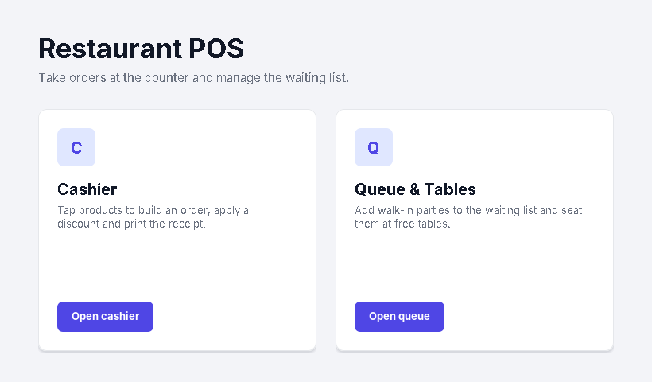
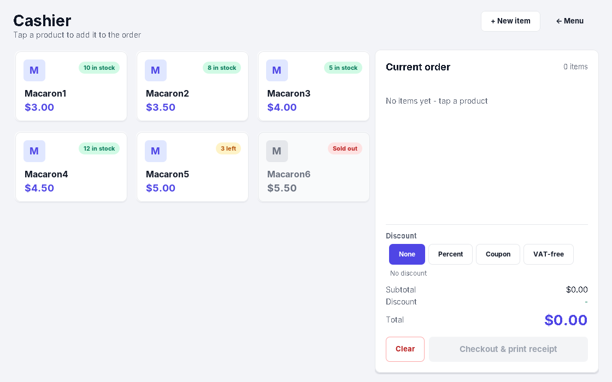
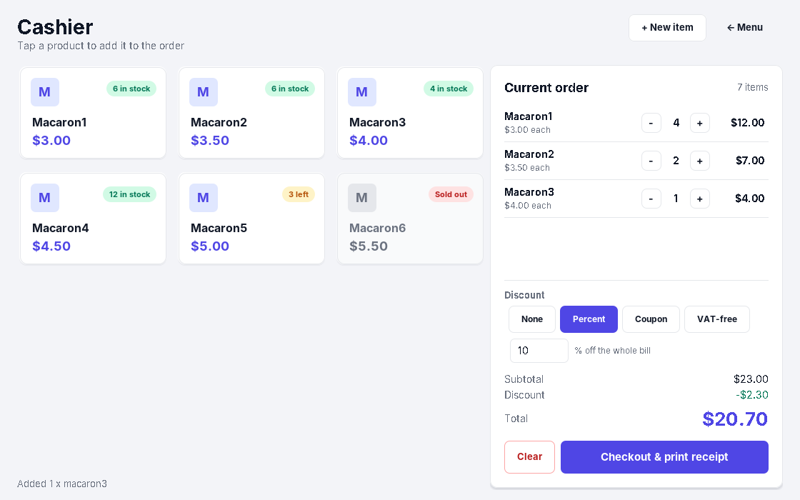
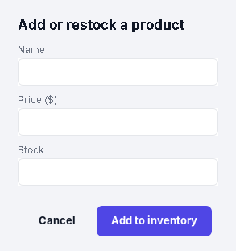
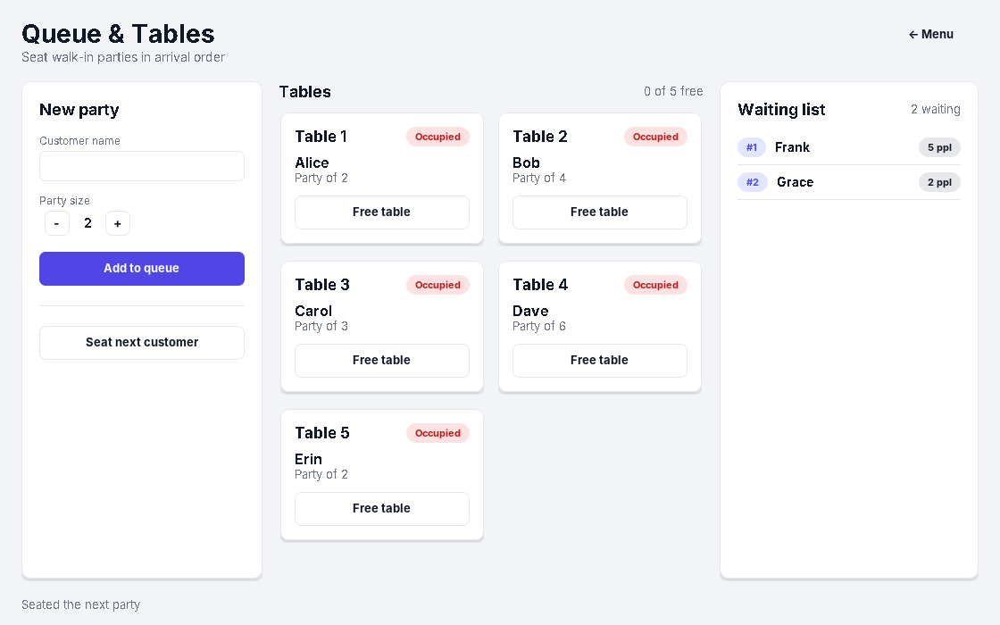
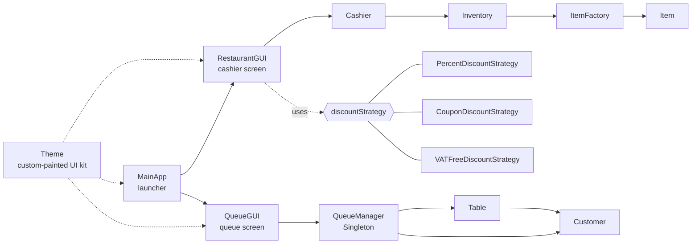
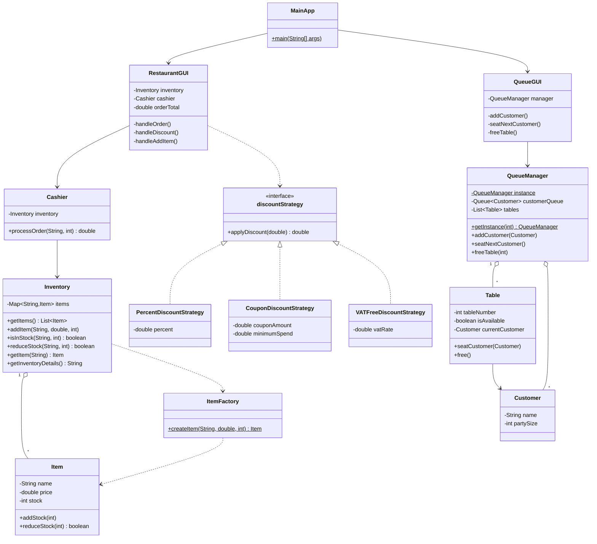

# Restaurant POS & Queue System (Java Swing)

A desktop **point-of-sale and table-queue app for a small restaurant or bakery**, written in plain Java with Swing. You start from a small menu and pick one of two parts: the **cashier** (inventory, orders, discounts) or the **queue and table manager** (a first-come-first-served waiting list, seat the next party, free up a table).

This was a team project for 2190103 Advance Computer Programming, so a big part of the point was practising object-oriented design: the **Strategy**, **Singleton** and **Factory** patterns, plus encapsulation, abstraction and polymorphism.


## Table of Contents
1. [Features](#features)
2. [Screenshots](#screenshots)
3. [Tech stack](#tech-stack)
4. [Architecture](#architecture)
5. [How it works](#how-it-works)
6. [OOP concepts and design patterns](#oop-concepts-and-design-patterns)
7. [Example run](#example-run)
8. [How to run](#how-to-run)
9. [Repo structure](#repo-structure)
10. [Limitations](#limitations)

## Features

**Launcher (`MainApp`)**
- A clean, flat start screen with two cards: *Cashier* and *Queue & Tables*.

**Cashier (`RestaurantGUI`)**
- Product tiles with name, price and a stock badge: green "in stock", amber "N left" once there are 3 or fewer, red "Sold out". It starts with six demo products (`Macaron1`-`Macaron6`), one of them already sold out.
- **Tap to add**: each tap adds one. The order panel lists each item with a `- qty +` stepper, a line subtotal and an item count. It won't let you add more than what's in stock, and taking a line down to 0 removes it.
- **Discount buttons**: None / Percent / Coupon / VAT-free. Each one is its own strategy class, and the subtotal, discount and total update as you go:
  - *Percent*: take off whatever percentage you type in
  - *Coupon*: a fixed amount off, but only if the bill is big enough (the GUI sets the minimum to 4x the coupon amount)
  - *VAT-free*: takes out the 7 % VAT (`price / 1.07`)
- **Checkout and receipt**: stock gets taken off through `Cashier.processOrder`, a paper-style receipt pops up (date/time, items, subtotal, discount, total), and the tiles update.
- **+ New item** lets you add a new product or restock an existing one (with input checks).

**Queue (`QueueGUI`)**
- Add a party (name and party size; pressing Enter works too) to the waiting list.
- **Seat next customer** takes whoever's first in line and puts them at the first free table. If nobody's waiting or every table is taken, the status line tells you.
- Five table cards, each showing Available / Occupied, the guest's name, the party size and a **Free table** button.
- The waiting list shows each party's place in line (#1, #2, ...) and size. The header shows "N of 5 free" and "N waiting".

**UI toolkit (`Theme`)**
- Our own small design system in pure Swing: a colour palette, font fallbacks (Inter / Segoe UI / Helvetica Neue / Roboto / Arial), rounded cards with soft shadows, flat buttons with hover and pressed states, chips, a stepper and rounded text fields. All of it is drawn by hand with anti-aliased `Graphics2D`, no third-party look-and-feel.

## Screenshots

Taken from the actual app running on a virtual display (Xvfb), with a script clicking the buttons and typing into the fields. Demo data only.

| Launcher | Cashier (empty order) |
|---|---|
|  |  |

| Order with 10 % discount (subtotal $23.00, total $20.70) | Receipt |
|---|---|
|  |  |

| After checkout (stock updated, "Sold out" tile) | New item dialog |
|---|---|
|  |  |

| Queue (empty) | 7 parties waiting |
|---|---|
|  |  |

| 5 tables occupied, 2 waiting | Table 2 freed, next party seated |
|---|---|
|  |  |

> There's **no login, user accounts or admin panel**. See [Limitations](#limitations).

## Tech stack
- **Language:** Java, standard library only (`javax.swing`, `java.awt`, `java.util`)
- **UI:** Swing (`JFrame`, `JDialog`, `BorderLayout`, `GridLayout`, `BoxLayout`) with a hand-drawn flat theme (`Theme.java`, `Graphics2D`)
- **Build:** nothing special, just compile the `.java` files with `javac`
- **Dependencies:** none

## Architecture



Class diagram:



We kept the **business logic** (`Item`, `Inventory`, `Cashier`, the discount strategies, `Customer`, `Table`, `QueueManager`) apart from the **screens** (`MainApp`, `RestaurantGUI`, `QueueGUI`). None of the logic classes touch Swing, so they could be tested on their own or used with a different UI.

## How it works

**Ordering**
1. In `RestaurantGUI` you tap a product. The GUI checks `Inventory.isInStock(name, cartQty + 1)` and adds it to the cart (a `LinkedHashMap<String,Integer>`), or bumps the quantity. The stepper on each line changes it too.
2. On *Checkout*, `Cashier.processOrder()` handles each line: it lower-cases the name, looks the item up in `Inventory`, checks the stock, works out `price x qty` and calls `reduceStock`.
3. The GUI shows the receipt (subtotal, discount type, total), empties the cart and refreshes the products.

**Discounts**
1. When you pick a discount, the GUI creates the matching `discountStrategy` and calls `applyDiscount(subtotal)`. The calling code doesn't need to know which one it has. Totals update right away.
2. `PercentDiscountStrategy`: `total x (100 - p) / 100`. `CouponDiscountStrategy`: `max(0, total - coupon)` if `total >= minimumSpend`, otherwise nothing changes. `VATFreeDiscountStrategy`: `total / (1 + vatRate)`, with 7 % in the GUI.
3. The discounted total is what ends up on the receipt.

**Queue**
1. `QueueManager` is a Singleton set up with 5 tables. The waiting list is a `Queue<Customer>` on top of a `LinkedList`, so first in, first out.
2. `seatNextCustomer()` takes the first party in line and seats them at the first table where `isAvailable()` is true. If no table is free, they stay in line.
3. `freeTable(n)` clears the guest and marks the table as available again.

## OOP concepts and design patterns

| Concept | Where |
|---|---|
| **Strategy pattern** | `discountStrategy` interface with `PercentDiscountStrategy`, `CouponDiscountStrategy`, `VATFreeDiscountStrategy`. Adding a new kind of discount doesn't need changes in `RestaurantGUI` apart from the selector |
| **Singleton pattern** | `QueueManager.getInstance(int)`: private constructor, one shared copy of the queue and tables |
| **Factory pattern** | `ItemFactory.createItem(...)`, used by `Inventory.addItem` to make `Item`s |
| **Encapsulation** | private fields with getters in `Item`, `Customer`, `Table`; stock only changes through `addStock`/`reduceStock`, which won't go below zero |
| **Abstraction / interface** | `discountStrategy` hides how each discount is worked out |
| **Polymorphism** | `discountStrategy coupon = new CouponDiscountStrategy(...)`, with `applyDiscount` picked at runtime |
| **Composition** | `Cashier` has an `Inventory`; `Inventory` has many `Item`s; `QueueManager` has `Table`s and `Customer`s; a `Table` has a `Customer` |
| **Custom components / inheritance** | `Theme.Card`, `Theme.Btn`, `Theme.Chip`, `Theme.Stepper` extend Swing components and override `paintComponent`; `ProductTile` extends `JButton` |
| **Collections** | `HashMap<String,Item>` (inventory), `LinkedList`/`Queue` (waiting list), `ArrayList` (tables) |
| **Event-driven GUI** | `ActionListener`s with lambdas and method references, mouse hover listeners, `SwingUtilities.invokeLater` at start-up |

## Example run
- The console prints the same things the GUI does, for example `4 x macaron1 = $12.00` and `Alice (Party of 2) seated at Table 1`.
- In the run used for the screenshots: 4 x Macaron1 ($12.00) + 2 x Macaron2 ($7.00) + 1 x Macaron3 ($4.00) came to $23.00, and with 10 % off the receipt said **$20.70**. Macaron1 stock went from 10 to 6. Five parties got tables 1-5 in the order they arrived. After table 2 was freed, the next party (Frank) got it and Grace was left waiting.

## How to run

You need a JDK (11 or newer is best) and a screen.

```bash
git clone https://github.com/kookithub/2190103_Advance_Computer_Programming_POS_Project.git
cd 2190103_Advance_Computer_Programming_POS_Project
javac *.java
java MainApp
```

Without a screen (that's how the screenshots were made): `xvfb-run -a java MainApp`.

## Repo structure
```
.
├── Theme.java                    # hand-drawn flat UI toolkit (cards, buttons, chips, stepper)
├── MainApp.java                  # launcher / entry point (main)
├── RestaurantGUI.java            # cashier window (products, cart, receipt)
├── QueueGUI.java                 # queue + table cards window
├── Cashier.java                  # order processing
├── Inventory.java                # item store (HashMap)
├── Item.java                     # product
├── ItemFactory.java              # Factory
├── discountStrategy.java         # Strategy interface
├── PercentDiscountStrategy.java
├── CouponDiscountStrategy.java
├── VATFreeDiscountStrategy.java
├── QueueManager.java             # Singleton: queue + tables
├── Table.java
├── Customer.java
└── docs/images/                  # screenshots + demo GIF
```

## Limitations
- Nothing is saved: inventory and the queue are in memory and reset when you restart.
- No login, roles, admin panel, sales reports or real receipt printing (the receipt is just an on-screen dialog).
- A discount applies to the whole bill, and only one per order.
- Seating doesn't look at party size, and the number of tables (5) is a constant in `QueueGUI`.
- No automated tests. Also, the interface name `discountStrategy` should really be `PascalCase` by Java convention.
